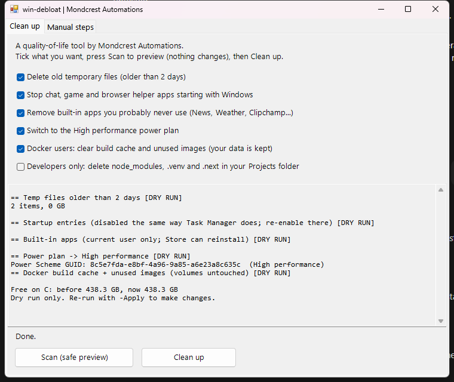
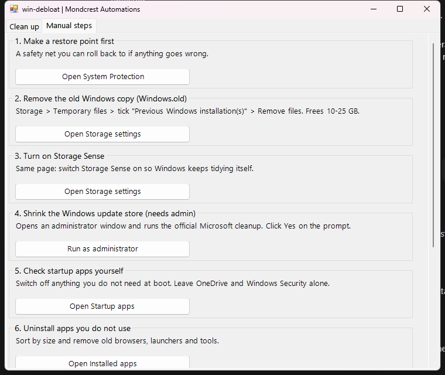

# win-debloat

> **A quality-of-life side project.** Built and shared by [Mondcrest Automations](https://mondcrest.com), a B2B AI agency. It is not part of our agency services.

> ## ⚠️ IMPORTANT: create a System Restore point first
> Before you click **Clean up** (or run with `-Apply`), create a Windows **System Restore point** so you can roll back if anything goes wrong: press Start, type "Create a restore point", choose your C: drive and click **Create**. The dashboard's Manual steps tab opens this for you. This tool has been tested on a Windows 11 PC and a Windows 10 laptop. You use it at your own risk.

A safe, reversible Windows 11 cleanup. **Dry run by default**: it only reports until you click Clean up (or pass `-Apply`).

## Easiest way: the dashboard (no technical skills needed)
1. Click **Code > Download ZIP** on this page and unzip it.
2. Double-click **`Start-Dashboard.cmd`**. (If Windows warns, choose More info > Run anyway.)
3. Tick what you want, press **Scan** to preview (nothing changes), then **Clean up**.
4. The **Manual steps** tab walks you through the parts Windows requires you to do yourself: restore point, Windows.old, the update-store cleanup (admin), startup apps, drivers, Docker disk shrink, restart.




> **Review the lists first.** The default startup and app lists (Steam, Discord, Opera GX, Roblox, Clipchamp...) are common bloat but may include things you use. Scan shows exactly what would change before anything happens, and you can edit the lists with `-StartupOff` and `-Apps`.

## Command line
One PowerShell script, `debloat.ps1`:

```powershell
.\debloat.ps1                         # report what it would do
.\debloat.ps1 -Apply                  # temp files, startup, apps, power plan, Docker cache
.\debloat.ps1 -Apply -Only Temp,Power # just some steps
.\debloat.ps1 -Apply -Only Dev -Root C:\code   # also delete node_modules/.venv/.next (opt-in)
```

| Step | What it does | Undo |
|---|---|---|
| Temp | Deletes `%TEMP%` items older than 2 days | n/a |
| Startup | Disables listed per-user startup apps (Task Manager method) | Task Manager > Startup apps |
| Apps | Removes listed built-in apps for the current user | Microsoft Store |
| Power | Sets High performance plan | `powercfg /setactive` |
| Docker | Prunes build cache and unused images. **Never volumes** | rebuild images |
| Dev | Deletes `node_modules`, `.venv`, `.next` under `-Root` (opt-in only) | `npm install` / recreate venv |

Edit the lists with `-StartupOff` and `-Apps`. Xbox apps are left alone on purpose.

## Not automated (needs admin, run yourself)
```powershell
Dism.exe /online /Cleanup-Image /AnalyzeComponentStore
Dism.exe /online /Cleanup-Image /StartComponentCleanup
```
Remove `Windows.old` via Settings > System > Storage > Temporary files. After Docker pruning, run `wsl --shutdown` and `Optimize-VHD` on `docker_data.vhdx` to reclaim the disk file.

## Requirements
Windows 11 or Windows 10 (both tested), built-in Windows PowerShell 5.1. No installs, no admin needed for the dashboard or script; only the manual DISM step needs admin.

## Safety
No registry hacks, no telemetry service tweaks, no remote scripts, nothing downloaded. Read `debloat.ps1` before running; it is one file. Create a restore point first.

Provided as is, with no warranty. You run it at your own risk, so scan first and make a restore point.

MIT licensed. Made by [Mondcrest Automations](https://mondcrest.com), a B2B AI agency.
